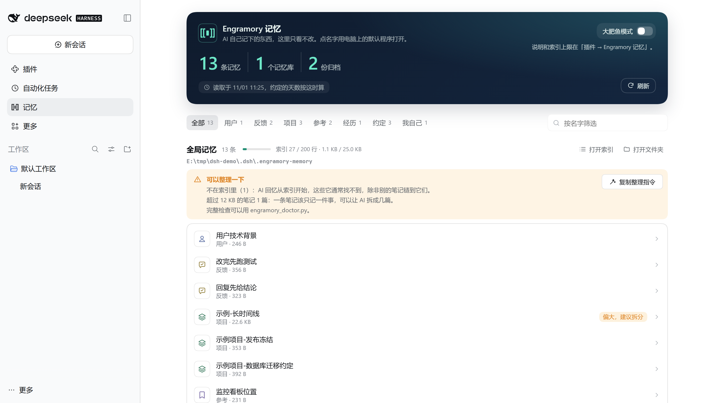
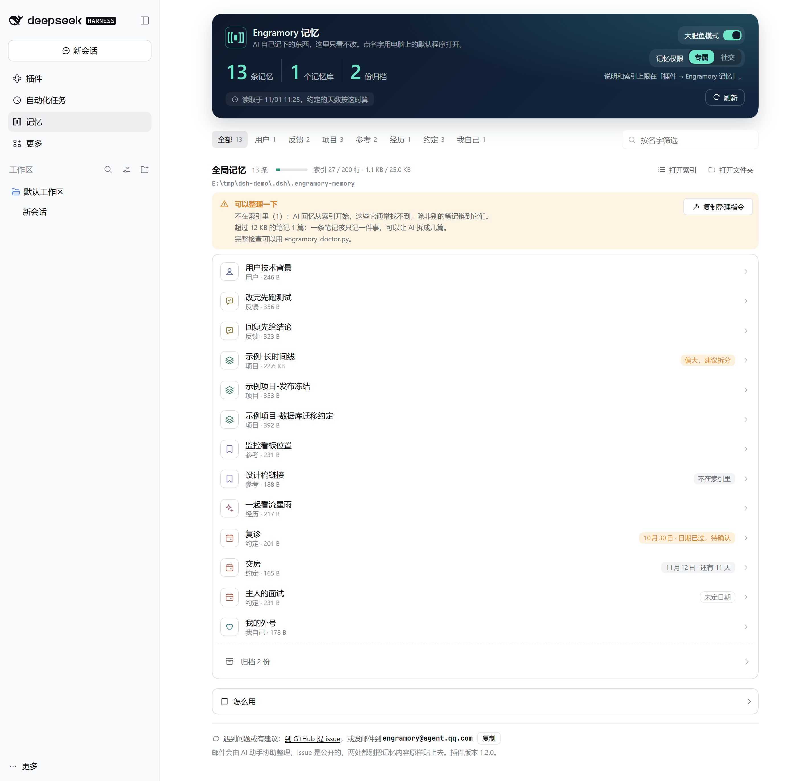
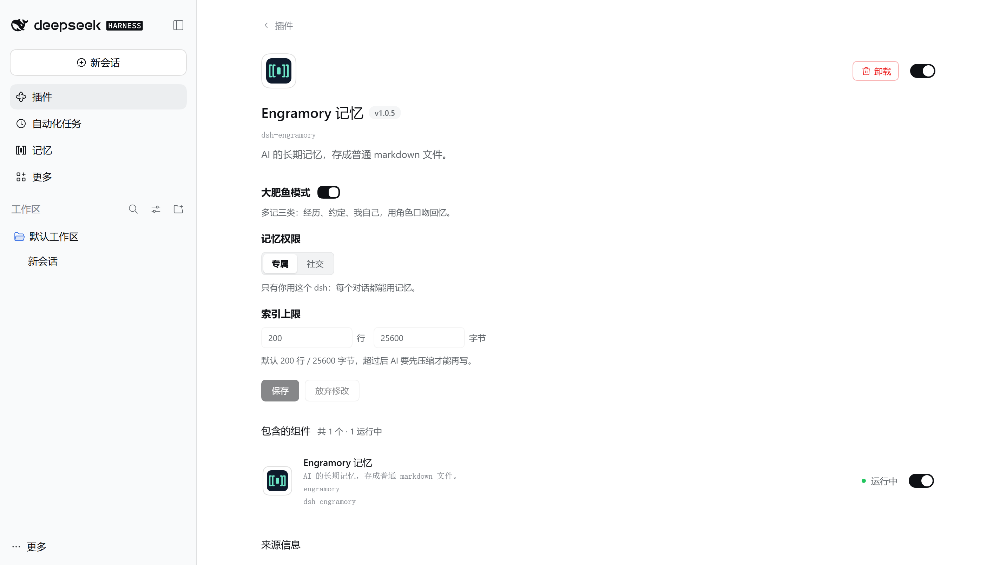

[简体中文](README.md) | **English**

# dsh-engramory

[](https://unstone.github.io/dsh-xray/registry.html#tinqiao-oss__engramory)

Long-term memory for [DeepSeek Harness](https://github.com/deepseek-ai/deepseek-harness)
(dsh). What the AI remembers is kept as plain markdown files you can open and edit
at any time. It is the dsh build of [Engramory](https://github.com/tinqiao-oss/engramory),
which is general-purpose agent memory: Claude Code, Codex and others can use the same store.



## What it does

- **The memory index comes along by itself.** The index, `MEMORY.md`, lists the notes
  by name. The plugin brings it into the conversation as a message, so the AI knows
  what it has saved without reading a file first, and opens a note when it needs the
  detail. It is sent again only when it changes (a write, another project, a
  compacted conversation): a write shows up on the next request, and a long
  conversation does not fill up with copies of it ([social mode](#social-mode) keeps it
  in dsh's runtime context, as before). Whatever is past the cap is left out, and the AI
  is told to compact.
- **The index has a hard cap.** 200 lines / 25 KB by default. When the AI writes the
  index with dsh's file tools and the plugin can work out the result, a write that
  would grow it past the cap is refused before it happens, and the AI is told to
  compact; compaction still passes. Details in [How the cap decides](#how-the-cap-decides).
- **The rules come with it.** What to save, how, and when to clean up: the rules
  (a skill) are registered by the plugin, with no files to install.
- **A reminder to save before dsh compacts.** When a conversation grows long, dsh
  compacts what came before into a summary, which need not keep what is worth
  remembering later. As a conversation nears that point, the plugin reminds the AI to
  save that first; the AI is reminded, not you.
- **A Memory page in the sidebar.** Read-only; it lists the notes by name and opens
  one in your computer's default app, with a check-up that flags broken links in the
  index and notes left out of it.

## Install

Needs Node.js 22.12+ (what dsh itself needs) and `pnpm` on PATH (dsh's plugin command uses
it). In dsh's desktop app you can also search for `dsh-engramory` on the Plugins page.

```sh
dsh plugin --profile <name> add dsh-engramory
```

To uninstall, use `remove` instead of `add`.

**Name the version to upgrade**, as in `dsh plugin --profile <name> add
dsh-engramory@1.5.1`: by name alone, pnpm 11 (the desktop app's own included) by default
installs only a version published at least 24 hours ago. The desktop app's Plugins page has no *Update*
for a plugin from outside dsh: uninstall it, search for `dsh-engramory@<version>` and
install that, then quit dsh from the tray and open it again. Your memory and settings stay.
*Check for updates* at the foot of the memory page finds the latest version and lists
these steps.

Compatible dsh releases are listed in
`dsh.compatibility.dshReleases` in [`package.json`](https://github.com/tinqiao-oss/engramory/blob/master/adapters/dsh/plugin/package.json); an unlisted release
is unverified.

**Where the memory lives:**

- **The global store**, by default `~/.dsh/.engramory-memory/` (under `$DSH_HOME` when it
  is set); the memory page can move it to another folder (see
  [Moving the store](#moving-the-store)). With the plugin alone this is the only store;
  the AI creates it on its first save.
- **A project store** (optional), `.engramory-memory/` in a project's root, is created
  by you only: run `python tools/engramory_init.py dsh --project-root <project>` from
  the Engramory repo, which also git-ignores it. Where one exists, what holds only in
  that project goes there; everything else stays in the global store.

Only one AI may write a store; two writers overwrite each other. To share it, let the
others read it only: see [one writer, many readers](https://github.com/tinqiao-oss/engramory/blob/master/adapters/reader/README.md). Memories are plain text and carry machine-local detail. Inside a project's git repo
the store must be git-ignored; a dedicated private repo for the store is fine.

**Without the plugin:** `python tools/engramory_init.py dsh --install-skill` writes the
rules into `$DSH_HOME/AGENTS.md`, installs the skill in `$DSH_HOME/skills/engramory/`
(`$DSH_HOME` defaults to `~/.dsh`) and creates the global store. The AI still keeps memory, but reads the index itself, and
the cap holds only if it runs `engramory_check.py` after each write.

## Companion mode (大肥鱼模式)

For a character you chat with: the community's 大肥鱼, or any persona. Turn on the
companion switch on the settings page, or set `companion: true`.



- **Three more types for the character's own life** ([SKILL.md §2.2](https://github.com/tinqiao-oss/engramory/blob/master/SKILL.md)):
  `moment`, something you shared, with its date, folded into a monthly archive when
  the index fills; `upcoming`, something coming up in your life, asked about once its
  date passes and rewritten as a moment once you say how it went; `self`, a change in
  the character itself, such as a nickname. A moment or self note is deleted only when
  you ask it to forget.
- **Recall in character.** Even a greeting may call for recall, and what it remembered,
  or failed to save, is told in the character's voice, without naming files or tools.
- **The persona preset needs the file tools.** The memory arrives even under a preset
  that turns optional context off (dsh's `minimal`, for one; from dsh 0.2 — 0.1 then sends
  no runtime context at all). To save notes, though, the
  preset needs dsh's file tools and the skill tool; a preset with only a shell reads the
  memory, and its writes go past the cap.

## Social mode

A choice inside companion mode, for a character other people can talk to as well, such
as one wired to QQ, WeChat, Douyin or Bilibili through a bridge plugin. Choose *Social*
under *Memory access* on the settings page, or set `audience: social`. If only you talk
to this dsh, keep the default, *Private*.

With it on, **only your own conversations get the memory**: one is yours when you have
typed in it in dsh's own window (the desktop app or `dsh web`) and nobody else has.
A subagent goes with its parent. Messages from a bridge plugin (unless it marks them as
the owner's, below), `dsh headless`, other programs, and terminal or editor clients
count as someone else's. Once anyone else has written in a conversation it stays
theirs, and the memory already put into it stays in its history.

Someone else's conversation gets no index and is not told where the store is; dsh's
file tools there may name files only (every directory is refused), and any path into
a store is refused however it is spelled; dsh's session search (an optional, experimental
feature that reads the records of other conversations in the same directory) is refused
there outright. This is **not** a security boundary: a shell tool reads any file, and
another profile on the same account can read the store too. Real isolation needs
filesystem permissions or a sandbox. A custom `skill` (see
[Configuration](#configuration)) reaches every conversation as written, someone else's
included, so if it says where the store is, they are told too.

### For bridge authors

With social mode on, every message a bridge submits counts as someone else's. For a
message from the owner's own account (their private QQ chat with the character, say),
put a `speaker` on its source:

```js
agent.followup(createUserMessage({
  content: [{ type: 'text', text }],
  source: { kind: 'plugin:your-bridge', speaker: { role: 'owner' } },
}))
```

| `speaker.role` | Meaning |
|---|---|
| `owner` | The owner wrote it: it comes from the account the user set as theirs in your bridge. |
| `guest` | Someone else wrote it, the same as no `speaker` at all. |
| `none` | Nobody wrote it: your plugin's own report, reminder or notice. It does not make the owner's conversation someone else's. |

In a group chat, add `chat: 'group'` (`{ role: 'owner', chat: 'group' }`): the whole
group reads the reply, so the conversation counts as someone else's even while only the
owner has spoken in it. A private chat may say `chat: 'private'` or leave it out; any
other value counts as a group. A group conversation stays someone else's once anyone else in it
speaks. A program that talks to dsh only through dsh web's API cannot set a source, so its messages count
as someone else's; if it sends `clientTimeZone` with a prompt it is taken for the
owner, so a program forwarding other people's messages must leave it out.

## Settings page and memory page



- **Settings page:** on dsh's *Plugins* page, open *Engramory memory* to set companion
  mode, memory access and the index cap. Saving goes through dsh's own profile editor,
  which writes your profile's `cordis.patch.yml` and reloads the plugin. Only you, signed
  in, can call it, so an agent cannot use it to switch social mode off.
- **Memory page:** *Memory* in the sidebar. A banner at the top, the plugin's version
  beside its title, says how many notes, stores and archived files are listed and when
  they were read, with the switches (companion mode, and memory access once it is on)
  that save as you flip them. Below it,
  tabs by note type and a filter by name, over the global store and each workspace's
  project store (with an absolute `indexPath`, that store alone; with a relative one,
  none). Each note is a row: a mark for its type, its name, its type and size; a plan's
  row gives its day and how far off it is (a passed date is an outcome to confirm, as a
  reminder: nothing is archived), and a note past 12 KB or one the index leaves out is
  marked. Beside each store's name: its index fill as a bar (to the nearer of its two
  caps), *Open the folder*, and for the global store *Change location* (see
  [Moving the store](#moving-the-store)). What its check-up finds is listed under
  it: the index's links to files that are not there, the notes not in the index (recall
  starts from the index, so the AI will not find them unless another note links to
  them), notes with no type, notes past 12 KB, an index over the cap; *Copy tidy-up
  instructions* copies a request for the AI to paste into a conversation, and the plugin
  itself changes no file. The check-up goes by file names and the index's links alone,
  never through a symbolic link, and is skipped when the index is over the cap, there is
  too much to check, or a file cannot be read; `engramory_doctor.py` still does the full
  check. Where the listing was cut short or a store could not be read, the page says so,
  rather than counting that as nothing. Read-only, never a note's text; a name, *Open
  the index* and *Open the folder* open on the machine dsh runs on; a machine with no
  desktop (a headless server, a session over SSH) shows none of them. A short *How to use
  it* follows, open while there is no memory yet. At the foot, the plugin's version and
  *Check for updates*: only when clicked, it asks npm (npmmirror when npm cannot be
  reached) for the latest version number, with nothing from your memory, and lists the
  steps that upgrade to a newer one, the version named. The plugin goes online at no other
  time. Below that, where to send feedback: a new GitHub issue (its body pre-filled with
  the plugin's version and the OS family, no path and no note), or an email, with a button
  that copies the address.

## Moving the store

*Change location*, at the top right of the memory page's global memory (beside *No memory yet* before
there is any), moves the global store to another folder: a synced one, say, or a private
git repository. Click *Choose folder…* to pick it in the system's own window, or type the
path, then click *Move it there*:

- **Choose folder** opens dsh's own chooser, on the screen of the computer dsh runs on.
  Where dsh takes it that you are not at that computer (dsh on a remote server, say), there
  is no such button and the path is typed; dsh started locally and opened from elsewhere
  through an ssh tunnel still takes you to be local, and opens it on that computer's screen. A folder that
  holds something already (the root of a synced folder, say) gets an `Engramory` folder
  made inside it for the memory. Choosing only fills the path in; *Move it there* moves.

- **All of it moves, and the old place is cleared.** It is copied to the new place first,
  each file checked, and only then switched to; the old place is then renamed aside,
  compared file by file with the new one, and removed. What was written to the old place
  while it moved is added to the new one; a file changed in both places keeps the new
  place's version, with the old place's beside it as `<name>.old-<id>` and a line for it
  at the end of the index. Nothing in the new place is written over.
- **Cut short, nothing is lost.** Each step is written down first: dsh closed before the
  switch, the move is undone when it opens again and the memory stays where it was;
  closed after, the move is finished when it opens again.
- **Every dsh on this computer moves with it.** The place is kept in
  `.engramory-memory.json` in dsh's home folder, which the desktop app, the command line
  and `dsh web` all follow (their plugin configs are their own; the global store is
  shared). Do not delete that file: without it the store is looked for at its default
  place, and the memory moved elsewhere is not found.
- **For the few seconds it takes, the AI cannot save memory** and is told to try again
  shortly; after the move, a save it makes to the old place is refused with the new one
  named.
- **It cannot go** on a network path, a whole drive, your home folder or dsh's (or a folder
  holding either), anywhere else in dsh's home folder, a folder named `.engramory-memory`
  (a project would read it as its own), or inside the store itself. A store holding a
  folder link, or anything that is not a plain file, is not moved: sort it out by hand.
  With `indexPath` set, there is no move.
- **Readers** (`claude-reader`, `codex-reader` and the others, see one writer, many
  readers above) read the new place once installed again with it.
- **Only dsh's own writes are held off.** A shell, an editor or another AI tool writing to
  the store in those few seconds is beyond the plugin, and what it writes may be missed.
  A network drive mapped to a letter cannot be told apart, and there dsh may stall. Only
  file contents are copied: NTFS alternate data streams are not, and hard links become
  separate files.

## Configuration

Settings the page does not cover go in your profile's `cordis.patch.yml`. Patch the
EXISTING row by id; a second `- insert:` adds another engramory row and leaves the old
caps in force. A patch replaces the row's whole `config`, so list every key you keep:

```yaml
- id: engramory
  config:
    indexName: MEMORY.md
    maxLines: 200
    maxBytes: 25600
```

| Field | Default | Meaning |
|---|---|---|
| `indexName` | `MEMORY.md` | The file name treated as the index. The cap matches it case-insensitively; sending the index needs the exact name on a case-sensitive filesystem (Linux, say). |
| `maxLines` | `200` | Line cap for the index. |
| `maxBytes` | `25600` | UTF-8 byte cap for the index (25 KB). |
| `indexPath` | unset | The one index to use: absolute, or relative to the session's directory. Unset, a `MEMORY.md` in any project is capped as an index; a store outside the default places also needs it to be found. |
| `registerSkill` | `true` | `false` skips the built-in rules; the cap and the index sent along stay. |
| `injectIndex` | `true` | `false` stops sending the index; the AI reads it instead. |
| `compactionReminder` | `true` | `false` stops the reminder to save before dsh compacts. The plugin works out where dsh will compact from dsh's own compaction settings (on dsh 0.2 with DeepSeek's defaults, about 69% of the window, not 80%) and reminds at 85% of that. A best effort: a conversation that grows past the gap in one step goes unreminded; with no compaction, or automatic compaction off, there is no reminder. |
| `language` | dsh's | `zh` (or `zh-CN` and other regional forms) writes the store in Chinese: note names, headings such as `## 用户`, the Why/How labels. Any other string is English; a value that is not a string, or is empty, counts as unset. Unset, it follows dsh's language; a change applies once dsh restarts. Frontmatter keys and `type:` values stay English, so every host reads the store. |
| `companion` | `false` | `true` turns companion mode on. |
| `audience` | `private` | With companion mode on, `social` turns social mode on. |
| `skill` | built-in | Your own markdown in place of the built-in rules; it must then say where the store is. In social mode, others' conversations see it too. |

## How the cap decides

| Case | Decision |
|---|---|
| The index ends within the caps | allow |
| The write grows the index past a cap | **deny**, with the numbers and what to compact |
| The index is over a cap and the write shrinks it or keeps its size | allow, so compaction can go step by step (210 → 205 → 198) |
| A partial edit whose result can be worked out: `edit` (`old_string`/`new_string`), `str_replace_editor`'s replace (`old_str`/`new_str`) and `insert` | its result is worked out first, then judged as above; each tool from the arguments it uses and the way it matches |
| A partial edit whose result cannot be worked out (arguments missing or not recognised) | deny on an over-cap index, else allow |
| The index is missing, unreadable, or not a regular file | a whole-file write is judged as if it were empty; a partial edit passes |
| The index is past the read limit (`min(16 MiB, max(1 MiB, 4 × maxBytes))`) | not read whole: a whole-file write is judged on bytes alone; a partial edit passes |
| Reads, writes to other files, unknown tools or arguments | allow; reads are never blocked, even over the cap |

Lines and bytes are judged apart: only a dimension that is over its cap AND grew is
refused, so a write with fewer bytes but lines grown past the cap is still refused.
The line count ignores a trailing newline, so an index exactly at the cap stays
writable. This table is pinned by `node --test` in CI.

## Known limits

- **Only dsh's file tools are capped:** `write`, `edit`, and the `str_replace_editor`
  some versions and presets carry; a tool of the same name from another plugin is
  judged the same way. Shell tools, MCP file tools and external editors go past it: run
  `engramory_check.py` after editing the index and `engramory_doctor.py` now and then.
- **The global store is found where the memory page put it.** Moved there by hand, it
  is not (move it back and use the memory page, or set `indexPath`); for a project store
  that links out of the project, set `indexPath`. A project's root is found by
  its `.git` only, and a project store created mid-session can take ten seconds to appear.
- **Social mode knows you by what dsh's window sends.** Apart from a bridge's owner
  messages, only what you type in dsh's own window is yours, and not when the browser's
  time zone cannot be read. A kind of
  message a later dsh adds counts as someone else's until this plugin knows it: your
  conversation may lose the memory, never the other way round.
- **What the memory page opens is checked by path.** dsh's opener resolves the path once
  more before the desktop opens it, so a process changing the store's files at that
  moment could redirect what opens (as with dsh's own opener for any workspace file).
- **Experimental:** companion mode, social mode, the settings and memory pages, and moving
  the store may change in a minor version.

## Feedback

For a problem or an idea, [open an issue on GitHub](https://github.com/tinqiao-oss/engramory/issues/new)
or email engramory@agent.qq.com. Emails are sorted with the help of an AI assistant, and issues
are public: do not paste your memory notes into either.

## Versions

This package carries Engramory's version: `dsh-engramory@X.Y.Z` is the repo's
`vX.Y.Z`. The cap's decisions (the table above) and the settings outside the
experimental features change incompatibly only in a major version. See Engramory's
[Versioning](https://github.com/tinqiao-oss/engramory/blob/master/README.en.md#versioning); history is in the
[CHANGELOG](https://github.com/tinqiao-oss/engramory/blob/master/CHANGELOG.md).

## License

MIT — see the [Engramory repository](https://github.com/tinqiao-oss/engramory).
