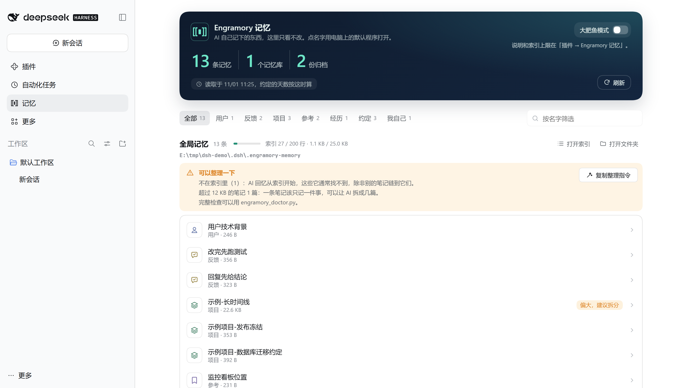
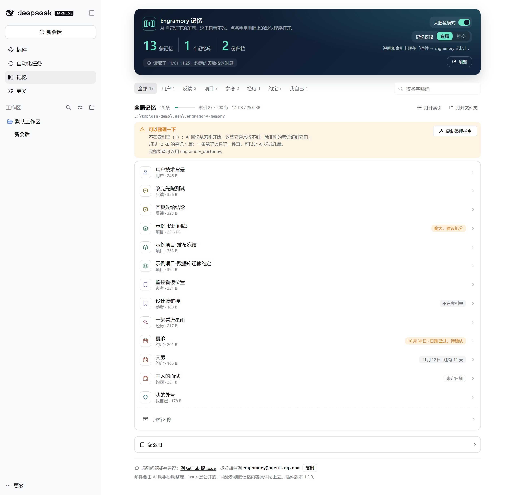
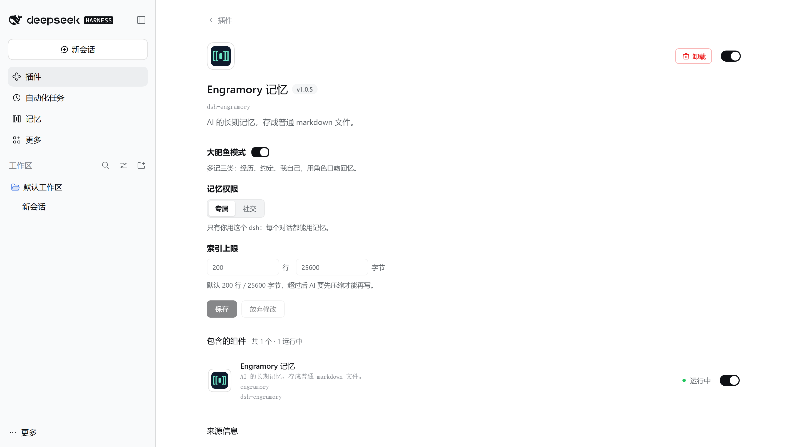

**简体中文** | [English](README.en.md)

# dsh-engramory

[](https://unstone.github.io/dsh-xray/registry.html#tinqiao-oss__engramory)

给 [DeepSeek Harness](https://github.com/deepseek-ai/deepseek-harness)（dsh）用的长期记忆插件。AI 记住的东西存成一个个普通 markdown 文件，你随时能打开看、能改。它是 [Engramory](https://github.com/tinqiao-oss/engramory) 的 dsh 专用版：Engramory 本身是通用的 AI agent 记忆，Claude Code、Codex 等也能用同一个库。



## 它做什么

- **自动带上记忆索引。** 索引 `MEMORY.md` 只列笔记名字，插件把它作为一条消息带进对话，AI 不用先读文件就知道自己记过什么，要细节再打开那条笔记。索引变了才再带一次（写入了、换到别的项目、对话被压缩过）：写入后下一步就能看到，长对话里也不会堆出一份份重复的索引（[社交模式](#社交模式)照旧放在 dsh 的运行时上下文里）。超出上限的部分不带上，并提醒 AI 压缩。
- **索引有硬上限。** 默认 200 行 / 25 KB。AI 用 dsh 的文件工具写索引时，只要插件算得出写完的样子，会超上限就在写入前拒绝，让它先压缩；压缩照样放行。细节见[上限怎么判](#上限怎么判)。
- **自带记忆规则。** 记什么、怎么记、什么时候清理，这套规则（skill）随插件注册，不用另外装文件。
- **快压缩时提醒 AI 存记忆。** dsh 会在对话太长时把前面压缩成摘要，摘要不一定留得下以后还用得着的东西。对话快到 dsh 要压缩的地方时，插件提醒 AI 把值得长期记住的先存进记忆；提醒的是 AI，不打扰你。
- **侧栏多一个「记忆」页。** 只读，列出笔记名字，点名字用电脑上的默认程序打开；顺带体检，标出索引里的坏链接和没进索引的笔记。

## 安装

需要 Node.js 22.12+（dsh 本身的要求），PATH 里要有 `pnpm`（dsh 的插件命令要用）。dsh 桌面版也可以在插件页搜 `dsh-engramory` 安装。

```sh
dsh plugin --profile <名字> add dsh-engramory
```

卸载把 `add` 换成 `remove`。

**升级要写上版本号**，比如 `dsh plugin --profile <名字> add dsh-engramory@1.5.0`：只写名字时，pnpm 11（桌面版自带的也是）默认只装发布满 24 小时的版本。桌面版的插件页对第三方插件没有「更新」按钮：先卸载，再搜 `dsh-engramory@<版本>` 安装，装完从托盘退出 dsh 再打开。记忆库和设置都会保留。记忆页底部的「检查更新」能查到最新版本号，并列出这几步。

兼容的 dsh 版本见 [`package.json`](https://github.com/tinqiao-oss/engramory/blob/master/adapters/dsh/plugin/package.json) 里的 `dsh.compatibility.dshReleases`，没列出的版本未经验证。

**记忆存在哪：**

- **全局库** 默认在 `~/.dsh/.engramory-memory/`（设了 `$DSH_HOME` 就在它下面），可以在记忆页换到别的文件夹，见[换位置](#换位置)。只装插件就用这一个，AI 第一次保存时自己建。
- **项目库**（可选）是项目根目录下的 `.engramory-memory/`，只能由你来建：在 Engramory 仓库里运行 `python tools/engramory_init.py dsh --project-root <项目>`，它会顺手加进 `.gitignore`。有项目库时，只在这个项目成立的事记在那里，其余仍记全局库。

一个库只能有一个 AI 写，同时写会互相覆盖；想让别的 AI 也用，让它只读，见[单写者、多读者](https://github.com/tinqiao-oss/engramory/blob/master/adapters/reader/README.md)。记忆是明文，带着本机细节。放在项目的 git 仓库里必须 git-ignore；给记忆库单独开一个私有仓没问题。

**不装插件也能用：** `python tools/engramory_init.py dsh --install-skill` 把记忆规则写进 `$DSH_HOME/AGENTS.md`、把 skill 装进 `$DSH_HOME/skills/engramory/`（`$DSH_HOME` 默认 `~/.dsh`），并建好全局库。AI 照样会记，但索引要它自己去读，上限只靠它写完后自觉运行 `engramory_check.py`。

## 大肥鱼模式

给陪你聊天的角色用（社区里的大肥鱼，或任何人设）。在设置页打开「大肥鱼模式」，或在配置里写 `companion: true`。



- **多记三类角色自己的事**（[SKILL.md §2.2](https://github.com/tinqiao-oss/engramory/blob/master/SKILL.md)）：`moment`（经历）是和你一起经历的事，带日期，索引满了按月归档；`upcoming`（约定）是你将要发生的事，日子过了会问起结果，问到了再改写成经历；`self`（我自己）是角色自己的变化，比如外号。经历和我自己只有你说忘掉才删。
- **用角色口吻回忆。** 打招呼也可能让它想起点什么；记住了、没记上，都用角色的话说，不提文件和工具。
- **人设预设要留着文件工具。** 记忆总会送到，哪怕预设关掉了可选上下文（比如 dsh 的 `minimal`；dsh 0.2 起，0.1 这时什么上下文都不带）。但角色要保存记忆，预设得带上 dsh 的文件工具和 skill 工具；只给了 shell 的预设读得到记忆，写入却绕过上限。

## 社交模式

大肥鱼模式里的一个选项，给别人也能聊的角色用，比如通过接入插件接到 QQ、微信、抖音、B 站的角色。在设置页「记忆权限」选「社交」，或写 `audience: social`。只有你自己跟这个 dsh 聊，就保持默认的「专属」。

打开后，**只有你本人的会话拿得到记忆**：你在 dsh 自己的窗口（桌面版或 `dsh web`）里亲手发过消息、且没有别人说过话的会话才算你的。子 agent 跟着它的父会话算。接入插件转来的消息（标明是主人的除外，见下文）、`dsh headless`、外部程序、终端和编辑器客户端发的都算别人的；一个会话只要有别人说过话，就一直算别人的，之前已经带进去的记忆仍留在对话记录里。

别人的会话拿不到索引，也不知道记忆库在哪；dsh 的文件工具只能指名文件（任何目录都不让列），指向记忆库的路径不管怎么写都拒绝；dsh 的会话搜索（可选的实验功能，能读同一目录下其他会话的记录）在别人的会话里一律不能用。这**不是**安全边界：shell 工具照样能读任何文件，同一账户下的另一个 profile 也读得到。要真正隔离，得靠文件权限或沙箱。自定义的 `skill`（见[配置](#配置)）会原样给所有会话，别人的也一样，里面写了库在哪，别人也看得到。

### 给接入插件作者

社交模式下，接入插件转进来的消息默认都算别人的。来自主人自己账号的消息（比如主人和角色的 QQ 私聊），在来源章上标 `speaker`：

```js
agent.followup(createUserMessage({
  content: [{ type: 'text', text }],
  source: { kind: 'plugin:your-bridge', speaker: { role: 'owner' } },
}))
```

| `speaker.role` | 含义 |
|---|---|
| `owner` | 主人发的：来自用户在你插件里设为"自己"的那个账号。 |
| `guest` | 别人发的，和不写 `speaker` 一样。 |
| `none` | 不是人发的：你插件自己的汇报、提醒或通知，不会让主人的会话变成别人的。 |

群聊里的消息再加上 `chat: 'group'`（如 `{ role: 'owner', chat: 'group' }`）：回复全群都看得到，所以就算群里只有主人开过口，这个会话也算别人的；私聊写 `chat: 'private'` 或不写，`chat` 是别的值都按群聊算。群聊里只要有别人说话，那个会话就一直算别人的。只通过 dsh web 接口发消息的程序设不了来源章，消息都算别人的；它若带上 `clientTimeZone`，会被当成主人，所以替别人转发消息的程序不要带。

## 设置页与记忆页



- **设置页**：dsh 的「插件」页里点开「Engramory 记忆」，能改大肥鱼模式、记忆权限和索引上限。保存走 dsh 自己的配置服务，写进你 profile 的 `cordis.patch.yml` 并重新加载插件。这个接口只有登录了的你能调，AI 没法调用它关掉社交模式。
- **记忆页**：左侧栏「记忆」。最上面一条横幅：标题旁是插件版本；列出了多少笔记、几个记忆库、多少归档，什么时候读的，还有两个开关（大肥鱼模式，打开后还有记忆权限），拨了就保存。下面按笔记类型分标签、可按名字筛选，列出全局库和各工作区的项目库（设了绝对路径的 `indexPath` 时只列那一个，相对路径则列不出）。每条笔记一行：类型图标、名字、类型和大小；约定那一行标出日期和还有几天（日期已过的写「待确认」，只是提醒，不会自动归档），超过 12 KB 的标「偏大，建议拆分」，不在索引里的也会标出。每个库名旁边是索引用量（进度条按两项上限里离得近的那个画）和「打开索引」「打开文件夹」，全局库还有「换位置」（见[换位置](#换位置)）。体检发现的问题集中列在库下面：索引里指向不存在的文件、不在索引里的笔记（AI 回忆从索引开始，除非别的笔记链到它们，否则通常找不到）、没写类型的笔记、超过 12 KB 的笔记、索引超上限；旁边的「复制整理指令」复制一段给 AI 的整理要求，粘贴进对话即可，插件本身不改任何文件。体检只按文件名和索引里的链接判断，不顺着符号链接走；索引超上限、要核对的太多或有文件读不了时不做，完整检查仍用 `engramory_doctor.py`。列表被截断或有库读不了时会注明，不把没列到的算成零。只读，不显示正文；点名字、「打开索引」「打开文件夹」都在运行 dsh 的那台机器上打开；没有桌面的机器（无界面服务器、SSH 连过去的）不显示这些按钮。下面有一段「怎么用」，还没有记忆时自动展开。页底是插件版本和「检查更新」：点了才向 npm（连不上再试 npmmirror）查最新版本号，请求里不带记忆内容；有新版就列出写上版本号的升级步骤。插件别的时候不访问外网。再下面是反馈入口：到 GitHub 提 issue（正文预先写好插件版本和系统类型，不带路径和笔记），或发邮件，地址可以一键复制。

## 换位置

记忆页「全局记忆」右上角的「换位置」能把全局库换到别的文件夹，比如网盘里，或者一个私有的 git 仓库（还没有记忆时，按钮在「还没有记忆」那行旁边）。点「选文件夹…」用系统自带的窗口选，或者直接填路径，再点「搬过去」：

- **选文件夹**用的是 dsh 自己的选择窗口，弹在 dsh 运行的那台电脑的屏幕上。dsh 认为你不在那台电脑前时（比如它跑在远程服务器上）没有这个按钮，填路径即可；在本机启动 dsh、再经 ssh 端口转发从别的电脑打开时，dsh 仍当你在本机，窗口会弹在本机屏幕上。选的文件夹里已经有东西时（比如直接选了网盘根目录），会在里面新建一个 `Engramory` 文件夹放记忆。选完只是填进路径，点「搬过去」才搬。

- **整个搬过去，旧位置自动清理。** 先复制到新位置、逐个文件核对，没问题才切换；再把旧位置改名挪开，和新位置逐个比对后删掉。搬的那几秒里后写进旧位置的，会补进新位置；同一个文件两边都改过的，旧位置那份存成新位置里名字带 `.old-<编号>` 的文件，索引末尾加一行指向它，不会覆盖新位置的内容。
- **中途被打断也不丢。** 每一步都先记下来：还没切换时 dsh 被关了，下次打开就撤销，记忆还在原处；切换之后被打断，下次打开接着做完。
- **这台电脑上的 dsh 一起换。** 位置记在 dsh 主目录的 `.engramory-memory.json` 里，桌面版、命令行和 `dsh web` 都按它走（插件配置各是各的，全局库是共用的）。别删这个文件：删了就回到默认位置，搬走的记忆就找不到了。
- **搬的那几秒 AI 存不了记忆**，会被告知过一会儿再存；搬完以后它要是还往旧位置写，会被拦下并告诉它新位置。
- **不能搬到**：网络路径、整个盘、用户主目录或 dsh 主目录（以及它们的上级）、dsh 主目录里别的地方、名叫 `.engramory-memory` 的文件夹（会被当成项目库）、记忆库自己里面。库里有目录链接或特殊文件时不搬，要手动处理。设了 `indexPath` 时不能搬。
- **装了只读者的**（`claude-reader`、`codex-reader` 等，见上面的单写者、多读者），换位置后用新位置重装一次，它们才读得到。
- **只协调 dsh 自己的写入。** 搬的那几秒里，shell、编辑器或别的 AI 工具正好在写记忆库，插件管不到，那次写入可能被漏掉。映射成盘符的网络盘插件认不出来，放在那里 dsh 可能卡顿。只复制文件内容：NTFS 的备用数据流不会带过去，硬链接会变成各自独立的文件。

## 配置

设置页没有的配置，写在你 profile 的 `cordis.patch.yml` 里：按 id 改已有的那一行，别再写一个 `- insert:`（那会多出第二行 engramory，旧上限照样生效）。一次 patch 会整体替换 `config`，要保留的键都列上：

```yaml
- id: engramory
  config:
    indexName: MEMORY.md
    maxLines: 200
    maxBytes: 25600
```

| 字段 | 默认值 | 含义 |
|---|---|---|
| `indexName` | `MEMORY.md` | 哪个文件名算索引。卡上限时不分大小写；带上索引时，在区分大小写的系统（如 Linux）上要和文件名完全一致。不是 `.md` 的索引，记忆页的「打开索引」只在文件夹里显示它，不用默认程序打开。 |
| `maxLines` | `200` | 索引行数上限。 |
| `maxBytes` | `25600` | 索引字节上限（25 KB）。 |
| `indexPath` | 不设 | 只认这一个索引：绝对路径，或相对会话目录。不设时，任何项目里叫 `MEMORY.md` 的文件都按索引卡上限；记忆库不在默认位置时也要设它，否则不会自动带上。 |
| `registerSkill` | `true` | `false`：不注册内置的记忆规则；上限和自动带上索引照旧。 |
| `injectIndex` | `true` | `false`：不再自动带上索引，改由 AI 自己读。 |
| `compactionReminder` | `true` | `false`：快压缩时不再提醒 AI 存记忆。插件照 dsh 的压缩设置算出它会在哪压缩（dsh 0.2 加 DeepSeek 默认约在窗口的 69%，不是 80%），到那一点的 85% 时提醒。尽力而为：一步就涨过这段余量的对话等不到提醒；没装压缩或关了自动压缩时不提醒。 |
| `language` | 跟随 dsh | `zh`（`zh-CN` 等也算）用中文写记忆（笔记名、`## 用户` 这类标题、**为什么：**/**怎么用：**），其他字符串用英文；不是字符串或为空，当作没设。不设就跟 dsh 的语言，改了要重启 dsh。frontmatter 的键和 `type:` 取值始终是英文，别的宿主照样能读。 |
| `companion` | `false` | `true` 打开大肥鱼模式。 |
| `audience` | `private` | 大肥鱼模式下设 `social` 打开社交模式。 |
| `skill` | 内置 | 用你自己的 markdown 换掉内置规则，这时得自己写明记忆库在哪。社交模式下别人的会话也看得到它。 |

## 上限怎么判

| 情况 | 结果 |
|---|---|
| 写完后索引在上限内 | 放行 |
| 写入让索引变大，并超过上限 | **拒绝**，报出数字，提示压缩什么 |
| 索引已超限，写入让它变小或不变 | 放行（压缩可以一步步来：210 → 205 → 198） |
| 算得出结果的局部编辑：`edit`（`old_string`/`new_string`）、`str_replace_editor` 的替换（`old_str`/`new_str`）和 `insert` | 先算出改完的结果，再按上面三条判；每个工具都只按它自己会用的参数和匹配方式算 |
| 算不出结果的局部编辑（参数不全或认不出） | 索引已超限时拒绝，否则放行 |
| 索引不存在、读不到，或不是普通文件 | 整文件写入当它是空的来判；局部编辑放行 |
| 索引大到超过读取上限（`min(16 MiB, max(1 MiB, 4 × maxBytes))`） | 不整份读：整文件写入只按字节比大小；局部编辑放行 |
| 读文件、写别的文件、不认识的工具或参数 | 放行；索引超限也不挡读取 |

行数和字节分开判：只拒绝既超上限、又比原来变大的那一项，所以字节变少但行数涨过上限的写入照样被拒。行数不算末尾换行，正好卡在上限的索引还能写。这张表由 CI 里的 `node --test` 固定。

## 已知限制

- **只拦 dsh 的文件工具**：`write`、`edit`，以及有的版本和预设带的 `str_replace_editor`；别的插件提供的同名工具也照样判。shell、MCP 文件工具和外部编辑器写入都绕过上限；改完索引跑 `engramory_check.py`，定期跑 `engramory_doctor.py`。
- **全局库要用记忆页换位置才找得到。** 自己挪到别处的不会自动找到（挪回来再用记忆页搬，或者设 `indexPath`）；项目库是指向项目外的链接时要设 `indexPath`；项目根只按 `.git` 认；会话中途新建的项目库最多十秒后才出现。
- **社交模式靠 dsh 窗口发来的信息认你。** 除了接入插件标明的主人消息，只有 dsh 自己窗口里打的字算你的；浏览器读不出时区时也认不出。dsh 以后新加的消息种类，插件认识之前都算别人的：你的会话可能拿不到记忆，但不会把记忆漏给别人。
- **记忆页打开文件前按路径检查。** dsh 的打开功能拿到路径后还会再解析一次，如果恰好在这一刻有程序改动记忆库里的文件，桌面最终打开的可能是别的东西（dsh 自己打开工作区文件也是这样）。
- **实验性功能**：大肥鱼模式、社交模式、设置页、记忆页和换位置在小版本里也可能改。

## 反馈

遇到问题或有建议，到 [GitHub 提 issue](https://github.com/tinqiao-oss/engramory/issues/new)，或发邮件到 engramory@agent.qq.com。邮件会由 AI 助手协助整理，issue 是公开的，两处都别把记忆内容原样贴上去。

## 版本

本包和 Engramory 用同一个版本号：`dsh-engramory@X.Y.Z` 就是仓库的 `vX.Y.Z`。上限判定（上面那张表）和实验性功能以外的配置，只在主版本做不兼容改动。详见[版本规则](https://github.com/tinqiao-oss/engramory#版本规则)，改动历史见 [CHANGELOG](https://github.com/tinqiao-oss/engramory/blob/master/CHANGELOG.md)。

## 许可

MIT，见 [Engramory 仓库](https://github.com/tinqiao-oss/engramory)。
